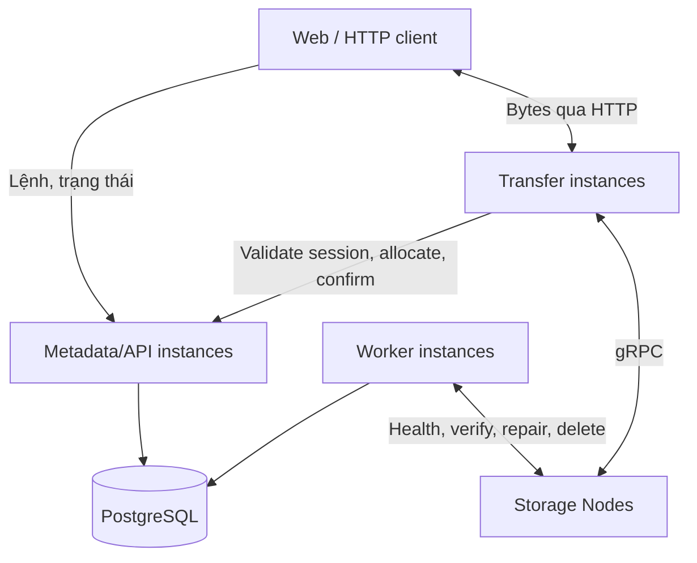

# Thiết kế V2 — lưu trữ tệp phân tán

**Ngày:** 21/10/2026. **Cập nhật:** 22/10/2026 sau phản biện thiết kế.
**Trạng thái:** thiết kế đích; các quyết định dưới đây cần được đặc tả và kiểm chứng khi triển khai.

Người dùng cho phép thiết kế lại toàn bộ, không dùng thời gian hoặc số thành
viên làm lý do thu hẹp kiến trúc. Tài liệu này xác định đích đến V2; không phải
bằng chứng hệ thống hiện tại đã có các khả năng dưới đây. Các tài liệu V1 tiếp
tục mô tả runtime hiện tại. REST/protobuf/schema V2 phải được đặc tả trước khi
triển khai từng boundary.

## 1. Mục tiêu và quyết định

- Hỗ trợ tệp lớn bằng xử lý từng phần, bộ đệm có giới hạn và backpressure.
- Upload tiếp tục được sau mất mạng, Transfer restart và API restart.
- Nhiều người upload/download đồng thời; không dùng khóa toàn hệ thống.
- Tách metadata khỏi đường truyền bytes; mở rộng API và Transfer độc lập.
- Replication theo failure domain, kiểm tra checksum, tự repair và cleanup.
- Một kho dùng chung: không tài khoản, đăng nhập, phân quyền người dùng hoặc
  quota theo người dùng. Giữ giới hạn tài nguyên và dung lượng của hệ thống.
- Có số đo, kiểm thử sự cố và quy trình phục hồi; không suy ra chất lượng từ
  số service hoặc công nghệ được đưa vào.

Giữ React, Python/FastAPI, PostgreSQL và gRPC làm phương án kỹ thuật ban đầu.
Chỉ đổi runtime khi benchmark chứng minh nút thắt liên quan đến runtime.
PostgreSQL lưu metadata và công việc bền vững; Storage tự lưu bytes. Không thay
phần lõi đồ án bằng dịch vụ object storage có sẵn.

### Phạm vi sản phẩm đã điều chỉnh

Kho tập trung về cách sử dụng: một danh sách tệp chung và một điểm truy cập
logic. Bytes vẫn được chia chunk và nhân bản trên nhiều Storage Node; không
gom toàn bộ lưu trữ về một máy. Các client trong môi trường demo tin cậy có
cùng khả năng xem, upload, download và xóa trong kho chung.

UI tập trung vào danh sách tệp, hàng đợi truyền, tiến độ, trạng thái node,
vị trí chunk và quá trình repair. Không làm đăng ký/đăng nhập, role, chia sẻ
theo người dùng, billing, thư mục hoặc lịch sử phiên bản cho người dùng trong
phạm vi này. Version/generation nội bộ vẫn cần cho tính đúng và chống thao tác cũ.

V1 đã hỗ trợ Storage trên nhiều host; giới hạn hiện tại là một Metadata
process và một operation lock cho các thao tác dữ liệu. V2 hướng tới nhiều
API/Transfer instance và nhiều phiên đồng thời. Tài liệu không xác nhận các
khả năng V2 đã được triển khai hoặc vượt qua nghiệm thu.

## 2. Thành phần và quyền sở hữu



| Thành phần | Trách nhiệm |
|---|---|
| Metadata/API | Catalog kho chung, upload session, placement, giới hạn tài nguyên, manifest và chuyển trạng thái |
| Transfer | Nhận từng phần, xác minh bytes, ghi bản sao, đọc streaming/Range; không tự quyết định trạng thái AVAILABLE |
| Storage | Chunk bất biến, atomic write, checksum, idempotent operations, bảo vệ khỏi thao tác cũ |
| Worker | Nhận job có lease, kiểm tra toàn file, health, repair, reconcile, cleanup |
| PostgreSQL | Nguồn sự thật cho trạng thái, manifest, reservation và job |

API không giữ trạng thái phiên chỉ trong RAM. Transfer dùng trạng thái tạm
trong thời gian request; request sau có thể tới instance khác. Worker có thể
dùng chung thư viện nghiệp vụ và DB với API, nhưng là process riêng.
Storage không công khai trực tiếp cho browser trong thiết kế cơ sở.

Việc tách Transfer chuyển tải bytes ra khỏi API; nó không loại bỏ giới hạn
băng thông của Transfer. Cần benchmark và nhiều instance để đánh giá mở rộng.

### 2.1. Streaming cho bytes, unary cho lệnh ngắn

Chốt `StoreChunk` là client-streaming và `GetChunk` là server-streaming giữa
Transfer/Worker và Storage. Mỗi stream xử lý một chunk; message đầu mang identity,
size/hash và write attempt, các message dữ liệu có offset liên tiếp và giới hạn
kích thước. Storage chỉ ACK sau EOF hợp lệ, đủ bytes, đúng hash và commit bền vững.
Stream đứt không được tính là một chunk hoàn tất; resume ở ranh giới part.
Health, prepare/inspect attempt và delete dùng unary với response có giới hạn;
inventory lớn phân trang. Browser tiếp tục dùng HTTP, không gọi gRPC trực tiếp.

Transfer đọc HTTP body theo từng block và đẩy tới các replica qua hàng đợi hữu
hạn. Replica chậm gây backpressure; hết deadline thì ghi nhận outcome chưa biết
và reconcile. Không tạo task/queue không giới hạn, không tự replay một stream
đã tiêu thụ; client có thể gửi lại part theo cùng identity sau đối soát.
Flow control của gRPC không thay cho admission và giới hạn buffer của ứng dụng
([gRPC flow control](https://grpc.io/docs/guides/flow-control/)).

Baseline để đo ở B–D: chunk 8 MiB, block/message dữ liệu tối đa 256 KiB,
tối đa 2 part đang gửi mỗi phiên, hàng đợi tối đa 2 block mỗi replica. Đây là
cấu hình khởi đầu, chưa phải kết quả benchmark. Mỗi process còn phải cấu hình
giới hạn stream, RPC, tổng buffered bytes và hàng đợi chờ; cấp budget trước khi
đọc body. Tính cả buffer thư viện/serialization và đo RSS thực tế; khi hết budget
thì từ chối hoặc chờ hữu hạn. Proxy phải tắt buffering toàn request/response cho
đường truyền này và có timeout phù hợp; kiểm chứng qua ingress thật ở C–D.

## 3. Mô hình dữ liệu và tính đúng

Các nhóm dữ liệu cần thiết:

- File/version bất biến và manifest theo thứ tự chunk.
- Upload session: size, expected full-file SHA-256, chunk size, RF/domain policy, expiration,
  trạng thái, version và kết quả hoàn tất.
- Upload part: session/index duy nhất, expected size/hash, chunk identity,
  trạng thái và generation của lần ghi.
- Replica và write attempt: allocation ID, node incarnation, generation, trạng thái, checksum/size,
  thông tin xác nhận và cleanup còn tồn đọng.
- Storage registry, health observation, capacity ledger và reservation có lease;
  lease hết hạn không tự giải phóng bytes có outcome chưa biết.
- Job: loại, đối tượng, deduplication key, lease owner/expiry, fencing token,
  retry state và lỗi cuối.
- Idempotency record và download lease. Idempotency key cho tạo phiên được
  sinh duy nhất bởi client, scope theo operation trong kho chung; cùng key với
  payload khác trả conflict. Không phụ thuộc user ID.

Các bất biến:

1. Chỉ công bố file khi manifest đầy đủ, size/hash đã kiểm chứng và mỗi chunk
   đáp ứng chính sách replica tại thời điểm quyết định commit.
2. ACK là bằng chứng lưu tại một thời điểm, không bảo đảm node sống mãi.
3. Cùng session/index và cùng bytes/hash cho cùng kết quả; nội dung khác
   nhận conflict, không âm thầm thay chunk.
4. Timeout có outcome chưa biết. Giữ attempt để reconcile; không suy ra bytes
   chưa tồn tại và không bỏ mapping cần cleanup.
5. Tệp đã tombstone không được repair hoặc late completion làm sống lại.
6. Tên tệp không được dùng làm đường dẫn Storage.
7. Transaction ngắn; không giữ khóa DB qua network/filesystem I/O.

## 4. Upload có thể tiếp tục

1. Client tính SHA-256 nguồn theo mục 4.1, tạo phiên với size, hash, tên và
   idempotency key. Server kiểm tra input,
   giới hạn tiếp nhận và capacity budget, snapshot chunk/RF policy rồi cấp ID.
   Reservation theo node được tạo nguyên tử khi allocate write attempt; tính
   cả reservation đang tồn tại để các upload không cùng chiếm một khoảng trống.
2. Client cắt tệp theo kích thước server cấp; có thể gửi một số phần song song,
   trong giới hạn đã công bố.
3. Transfer hỏi API để claim part và lấy placement/write attempt. Ý định ghi
   được lưu bền vững trước RPC.
4. Transfer đọc body có giới hạn, tính checksum từ bytes thật, kiểm tra size
   và ghi đủ replica. Không spool toàn bộ file tại API hoặc Transfer.
5. API ghi nhận kết quả bằng conditional update theo session state/generation.
   Client chỉ nhận part thành công sau khi xác nhận này đã commit.
6. Sau mất response hoặc mất mạng, client hỏi trạng thái part và gửi lại phần
   còn thiếu. Part có outcome chưa biết phải reconcile trước khi kết luận.
7. Complete đóng nhận part mới, kiểm tra manifest và tạo finalize job trong
   cùng transaction. Trả trạng thái đang xử lý; complete lặp lại trỏ cùng kết quả.
8. Worker đọc các chunk theo thứ tự, kiểm tra checksum và tính SHA-256 toàn
   file bằng bộ đệm giới hạn. API/domain transaction công bố AVAILABLE khi
   hash trùng expected hash của session và các điều kiện vẫn đúng;
   UI chỉ báo hoàn tất sau điểm này.

Tính hash của danh sách chunk hash không phải SHA-256 của bytes toàn file.
Thiết kế cơ sở chấp nhận thêm một lượt đọc khi finalize để kiểm chứng full-file
hash. Chi phí này phải được đo và hiển thị là giai đoạn xác minh.

Session: `OPEN → FINALIZING → COMPLETED`; có các nhánh `ABORTED`, `EXPIRED`,
`FAILED`. Lỗi tạm thời giữ job để retry có giới hạn, không tự biến mọi phiên
dang dở thành FAILED lúc API khởi động. Part được cố định trước FINALIZING.
Session rỗng có manifest rỗng và hash của chuỗi bytes rỗng.

Resume sau reload cần người dùng cấp lại quyền truy cập/chọn lại file nếu
browser không còn file handle. Xác minh phần gửi tiếp thuộc đúng file; không
chỉ dựa vào tên hoặc size. Không hứa browser tự giữ quyền đọc file sau restart.

### 4.1. Ràng buộc phiên với file nguồn

Chọn baseline dễ kiểm chứng: client đọc toàn bộ file một lượt để tính SHA-256
trước khi tạo session. `size` và `expected_sha256` bất biến từ lúc tạo; không cho
đổi hash của một session để tiếp tục bằng file khác. Cùng idempotency key nhưng
khác size/hash hoặc payload tạo phiên nhận conflict. File rỗng dùng SHA-256 của
chuỗi bytes rỗng. Tên và thời gian sửa file chỉ phục vụ hiển thị.

Web chạy incremental SHA-256 trong Web Worker, đọc từng block với bộ nhớ hữu hạn;
không gọi `file.arrayBuffer()` cho toàn file hoặc đưa toàn file vào
`crypto.subtle.digest()`: API này không nhận streaming input
([MDN digest](https://developer.mozilla.org/en-US/docs/Web/API/SubtleCrypto/digest)).
Chốt thư viện incremental hash và dependency lock khi làm client ở C; kiểm chứng
bằng test vector, file rỗng, boundary và đối chiếu SHA-256 backend.

Sau reload/chọn lại file, client tính lại full hash, đối chiếu size/hash với
session rồi mới resume. Mỗi part cũng gửi expected part hash; Transfer và Storage
tính từ bytes thực, claim đầu tiên cố định size/hash cho session/index. Finalize
đối chiếu full hash với giá trị đã cố định từ đầu; mismatch không được AVAILABLE
và kích hoạt cleanup. Vì vậy file bị đổi giữa lượt hash và lượt upload cũng không
được công bố nhầm. Đây là kiểm chứng nội dung, không phải xác thực người gửi.

Đánh đổi được chấp nhận: thêm một lượt đọc nguồn trước upload và sau mỗi lần
cần xác minh lại nguồn. UI có bước “Chuẩn bị/kiểm tra file”, tiến độ và hủy được;
không giữ capacity reservation trong lúc client còn pre-hash. Tối ưu một lượt đọc
chỉ thực hiện sau khi có evidence, không bỏ ràng buộc nội dung để tăng tốc.

### 4.2. Finalize có ngân sách riêng

Với RF=2, file 10 GiB tạo khoảng 20 GiB payload ghi replica và ít nhất 10 GiB đọc
để finalize, chưa tính retry/repair và overhead. Đo riêng thời gian gửi bytes,
thời gian chờ job, thời gian xác minh và tổng thời gian tới AVAILABLE.
Worker baseline đọc/hash tuần tự; crash giữa finalize có thể phải đọc lại từ đầu,
không checkpoint bằng hash của danh sách chunk hash.

Giới hạn số finalize đồng thời và băng thông đọc theo worker/cluster, chia lượt
I/O ở ranh giới chunk để file lớn không giữ toàn bộ tài nguyên. Finalize, download
và repair có budget riêng với phần tài nguyên tối thiểu để mỗi loại tiến triển;
không chỉ đặt ưu tiên khiến một loại đói vô hạn. Khi backlog vượt ngưỡng cấu hình,
giảm/từ chối nhận upload mới; session đã FINALIZING vẫn có job bền vững và trạng
thái chờ rõ ràng. Kill worker và tải hỗn hợp phải được kiểm chứng ngay ở C–D.

## 5. Download và xóa

- Tạo lượt đọc trên một version bất biến, có lease hết hạn; Transfer lấy
  manifest và đọc từng chunk, kiểm hash trước khi gửi bytes của chunk đó.
- Hỗ trợ GET/HEAD và một byte range: `206`, `Content-Range`, `Accept-Ranges`,
  strong ETag và `If-Range` theo RFC 9110. Range không thỏa trả `416`.
  Contract phải chốt cách xử lý multi-range và malformed range trước code.
- Replica lỗi được fallback có giới hạn. Chunk mất sau khi đã gửi headers
  làm response bị ngắt; không thể đổi response thành JSON lỗi lúc đó.
- Download không ghép toàn bộ file vào Blob trong frontend. Dùng cơ chế tải
  của browser; client chuyên dụng có thể resume bằng Range trên cùng ETag.
  Backend hỗ trợ Range không đồng nghĩa mọi browser tự resume được.
- Delete tombstone file ngay để chặn lượt đọc mới; lượt đọc có lease hợp lệ
  được tiếp tục. Cleanup chỉ xóa vật lý sau khi lease và write attempt liên
  quan đã được giải quyết; lease đang đọc phải gia hạn hoặc dừng khi hết hạn.
- Giới hạn download lease ngăn client treo giữ dữ liệu vô thời hạn.

Để thực hiện quy tắc kiểm hash trước khi phát bytes, Transfer giữ tối đa một
chunk hoàn chỉnh cho mỗi lượt đọc đang hoạt động trong budget đã cấp; baseline
không prefetch chunk tiếp theo. Sau khi xác minh mới phát chunk ra HTTP.
Streaming giảm việc gom cả file, không loại bỏ buffer kiểm chứng này. Một Range
nhỏ vẫn có thể cần đọc cả chunk liên quan; đo độ khuếch đại đọc và thời gian tới
byte đầu ở D. Không mở response download mới khi không còn budget cho chunk.

## 6. Đồng thời và phục hồi

Thay operation lock toàn process bằng unique constraints, conditional updates,
khóa bản ghi ở transaction ngắn và lease theo part/job/file khi cần.
Giới hạn số request, RPC và bytes đang đệm theo instance và phiên truyền;
admission budget toàn cluster lưu bền vững khi cần điều phối nhiều instance.

Job dùng PostgreSQL: claim một batch nhỏ bằng `FOR UPDATE SKIP LOCKED`,
ghi owner/expiry/token rồi commit trước khi làm I/O. Kết quả chỉ được ghi khi
token còn hợp lệ. Mutation tạo job phải commit cùng trạng thái cần xử lý để
không mất việc giữa hai lần ghi.

Lease hết hạn có thể dẫn tới hai worker cùng thực thi. Thiết kế là
at-least-once với tác dụng idempotent, không tuyên bố exactly-once.
Fencing trong DB một mình không ngăn RPC cũ ghi lên Storage.
Wire contract phải hiện thực cơ chế ở mục 6.1 cho write generation,
delete tombstone và retry; reject stale operation kể cả sau node restart.

Không có transaction nguyên tử xuyên PostgreSQL và filesystem các node.
Dùng persisted intent, idempotency và reconcile để xử lý khoảng trống giữa
Storage ACK và DB commit. Cleanup xử lý mọi destination đã thử, không chỉ
replica VERIFIED.

### 6.1. Fencing và vòng đời bản sao vật lý

Chọn một physical allocation ID ngẫu nhiên, không tái sử dụng, cho mỗi đích ghi.
Không deduplicate bytes giữa các file trong baseline. Identity gồm namespace V2,
recovery epoch, node incarnation và allocation ID. Incarnation được lưu bền vững
cùng volume; thay disk hoặc mất ledger cục bộ tạo incarnation mới và phải đăng ký
lại. Không phục hồi incarnation cũ chỉ bằng cách đặt lại node ID.

Metadata lưu allocation và reservation trước RPC. Generation tăng trong DB theo
allocation khi thay chủ attempt; job fencing token là token riêng. Storage có
ledger cục bộ bền vững cho generation cao nhất, size/hash và trạng thái allocation.
Chọn SQLite local với durable commits làm baseline; bytes nằm trong filesystem.
SQLite và file chunk không có transaction chung: intent, fsync file, atomic rename,
fsync directory và ledger commit phải có thứ tự/recovery case được đặc tả ở A.
Không giữ transaction SQLite qua stream/network; dùng khóa theo allocation cho
commit/delete, không khóa toàn node. ACK chỉ sau bytes và ledger đã bền vững;
startup đối soát mọi intent chưa hoàn tất trước khi phục vụ allocation đó.

| Thao tác | Quy tắc bắt buộc ở Storage |
|---|---|
| Prepare | Ghi generation bền vững; identity/size/hash cố định qua mọi generation của allocation; generation thấp bị từ chối |
| Store | Chỉ nhận allocation đã prepare; một writer mỗi allocation; kiểm generation/state cả lúc mở stream và trước rename/commit |
| Retry | Nếu đã STORED và khớp identity/hash, trả kết quả cũ mà không ghi thêm; WRITING chưa rõ outcome phải inspect/reconcile |
| Delete | Đánh dấu terminal DELETED bền vững trước dọn bytes, kể cả allocation chưa tồn tại; mọi Prepare/Store sau đó đều bị từ chối |
| Delete ACK | Chỉ trả kết quả giải phóng dung lượng khi writer cũ đã bị chặn/drain, tempfile và chunk đã dọn bền vững; crash giữa chừng tiếp tục dọn |
| Node rejoin | Kiểm incarnation/epoch và đối soát ledger; node mất ledger không được tự coi bytes cũ là replica hợp lệ |

Generation cao hơn không mở lại allocation DELETED. Repair sau khi xóa/corrupt
dùng allocation mới và reservation mới. Delete chỉ được phát sau quyết định
terminal đã commit trong DB; lần xóa lặp không tác động allocation thay thế.

Node chưa nhận generation mới/tombstone có thể vẫn hoàn tất write cũ. Không thể
hứa node offline biết ngay quyết định mới: DB từ chối late confirmation, giữ
attempt/reservation và gửi delete fence khi node kết nối lại. Đây là bytes mồ côi
cần dọn, không được đưa vào manifest. Không giải phóng reservation chỉ vì một lần
inspect thấy NOT_FOUND: phải đóng allocation bền vững để ngăn write tới muộn.

Baseline giữ tombstone/generation terminal gọn trong ledger suốt vòng đời namespace;
không GC theo TTL tùy ý. Dọn sớm bytes và tempfile, giữ bằng chứng chặn thao tác cũ.
Theo dõi kích thước ledger và dành headroom cho nó; chỉ thu hồi toàn bộ metadata
terminal khi namespace/incarnation được retire có kiểm soát, mọi writer cũ đã bị
cô lập và dữ liệu cần giữ đã chuyển sang namespace mới. Không xóa volume V1.

### 6.2. Reconcile/cleanup có từ upload đầu tiên

Mốc B phải có inspect/close allocation và recovery intent cục bộ; mốc C thêm worker
reconcile write attempt, abort/expiry và cleanup cơ bản. Mutation chuyển phiên
sang terminal và enqueue cleanup phải cùng transaction. Cleanup lặp được, có
lease/retry/backoff hữu hạn mỗi lượt và duyệt mọi destination đã thử.
Node offline giữ việc chờ bền vững, không quay vòng liên tục hoặc báo đã sạch.

Trước khi complete khóa manifest, phải giải quyết attempt còn chưa rõ outcome.
Complete đồng thời part đang ghi nhận conflict/retryable state theo contract;
không công bố manifest thiếu part. API/Worker restart nhận lại job có lease hết
hạn mà không reset phiên của instance khác. Mốc F mở rộng tự repair, scrub,
rejoin và fairness; không phải lần đầu hệ thống biết dọn upload lỗi.

## 7. Placement, health và repair

- Placement ưu tiên đủ distinct failure domain theo policy được snapshot;
  cấu hình strict mặc định từ chối ghi nếu không đáp ứng được domain policy.
- RF=2 có thể dùng hai host; muốn khôi phục hai domain khi một host mất cần
  domain thứ ba còn hoạt động và đủ dung lượng. Nhiều container cùng máy
  không tạo thêm khả năng chịu lỗi máy vật lý.
- Dung lượng từ health là snapshot. Reservation bền vững hạn chế overcommit
  giữa các upload; Storage vẫn phải kiểm tra hết disk thực tế.
- Poll có timeout/hysteresis, quan sát có generation để loại kết quả cũ.
  Không coi timeout là bằng chứng chunk mất hay node chết vĩnh viễn.
- Worker phát hiện thiếu replica và lên repair job có deduplication key.
  Nguồn phải qua checksum; chỉ ghi nhận replica mới sau ACK hợp lệ.
- Rejoin node cần reconcile; không tự tin mọi dữ liệu cũ còn đúng.
- Scrub checksum chạy theo ngân sách; repair, scrub và cleanup không được
  chiếm hết băng thông phục vụ người dùng.
- Rebalance là luồng riêng, chỉ xóa bản sao nguồn sau khi đích đã được xác nhận
  và policy vẫn được đáp ứng.

### 7.1. Sổ dung lượng: mỗi allocation bị tính đúng một lần

Chọn PostgreSQL ledger làm nguồn admission cho bytes do V2 quản lý. Mỗi node có
`allocatable_bytes` cấu hình từ dung lượng dành riêng cho namespace, đã trừ
headroom cho ledger, filesystem và vận hành. Với mỗi allocation, tính tối đa
expected size ngay từ lúc reserve, kể cả chưa ghi đủ. Tổng charged bytes gồm
RESERVED, WRITING/UNKNOWN, STORED và DELETE_PENDING; không cộng nhiều lần khi đổi
trạng thái. Chỉ RELEASED mới hết tính dung lượng.

`available_budget = allocatable_bytes - sum(charged_bytes)`.

Allocate trong transaction khóa bản ghi budget của các node theo thứ tự ổn định,
kiểm đủ budget, thêm ledger và cập nhật counter nguyên tử. Cùng allocation retry
không reserve thêm; ghi sang destination mới phải reserve riêng và giữ charge
ở destination cũ tới khi đã dọn. Part confirm chỉ chuyển trạng thái, không giải
phóng charge; reservation lease hết hạn chuyển sang reconcile, không RELEASED.
Counter phải đối chiếu được với các ledger row để phát hiện lệch.

Health free-space là tín hiệu cảnh báo/admission bổ sung; không dùng công thức
`health.free - toàn bộ reservation`, không cộng lại bytes chỉ vì có health mới.
Storage kiểm free-space thực tế và giữ local budget cho writer đang chạy trước
prepare, kiểm short-write/ENOSPC khi ghi. Mỗi allocation tối đa một tempfile hoặc
file cuối, rename trên cùng filesystem; retry phải drain/dọn temp cũ trước khi
ghi lại. Nếu cần bản sao tạm bổ sung thì phải tính thêm budget trước khi tạo.

Chỉ release sau Delete ACK theo mục 6.1 hoặc quy trình retire volume đã xác nhận.
Node mất liên lạc vẫn giữ charge. Node có bytes không khớp ledger, incarnation
mới hoặc DB restore chưa đối soát bị chặn placement mới; inventory theo trang,
quarantine bytes chưa rõ chủ và tính vào budget trước khi mở lại. Không tự tăng
budget từ một health snapshot hoặc coi file không có trong DB là rác để xóa ngay.

Tạo session chỉ kiểm điều kiện tiếp nhận sơ bộ và giới hạn active sessions;
baseline không hứa giữ đủ chỗ cho toàn file tới lúc upload xong. Reservation theo
node được cấp từng part. Hết chỗ giữa phiên trả lỗi capacity có thể thử lại, giữ
các part đã xác nhận tới expiry/abort. Contract/UI phải thể hiện giới hạn này.
Test race budget có ngay B–C và mở rộng nhiều instance ở E.

## 8. Kho dùng chung và vận hành

Không có user, login session, owner/role check, tenant isolation hoặc quota
theo tài khoản. Upload session là phiên truyền dữ liệu, không phải phiên đăng nhập.
Phạm vi triển khai là LAN/môi trường demo tin cậy; thiết kế này không cung cấp
quyền riêng tư hoặc quyền xóa riêng cho từng người dùng.

Transfer vẫn kiểm tra session tồn tại, state, part index, size/hash và generation.
Các kiểm tra này bảo đảm tính đúng của giao thức dù không có đăng nhập.
Endpoint xác nhận nội bộ chỉ dành cho các service trên mạng nội bộ, không đưa
ra browser như API công khai. Storage cũng chỉ phục vụ mạng nội bộ.

Giữ capacity reservation, giới hạn active sessions, part size, bytes đang đệm
và request concurrency. Reservation phải đối chiếu với kết quả ghi thực tế;
không hoàn trả capacity chỉ vì client ngắt khi Storage có thể đã ghi bytes.
Abort/expiry kích hoạt reconcile/cleanup, có evidence trước khi giải phóng phần
dung lượng đã dùng. Đây là quản lý tài nguyên cluster, không phải quota tài khoản.

Log có request/session/file/job ID; không log token hoặc bytes tệp.
Metrics gồm throughput, latency, retry, queue age, thiếu replica, dung lượng
reservation, RAM và thời gian finalize/repair. Không xây audit theo người dùng.
Readiness API, Transfer, Worker độc lập, không buộc API chết theo worker.

## 9. Nhiều instance và HA

V2 phải kiểm chứng ít nhất hai API instance và hai Transfer instance:
request phiên kế tiếp có thể đến instance khác; không cần sticky session.
Startup không reset health toàn cluster hoặc fail upload thuộc instance khác.
Worker dùng claim/lease thay cho scheduler độc quyền trong API.

Nhiều instance không đủ để tuyên bố toàn hệ thống HA. Mốc HA riêng phải có:

- PostgreSQL primary/standby, cơ chế failover và fencing primary cũ.
- Chính sách replication xác định rõ khi nào một ACK metadata được xem là
  bền vững; không hứa RPO=0 với replication bất đồng bộ.
- Điểm truy cập/load balancing không phụ thuộc duy nhất một process/host.
- Backup metadata và dữ liệu cùng quy trình reconcile/restore nhất quán.
- Đo RPO/RTO và kiểm thử network partition; không tự promote hai DB writer.

Chọn công cụ PostgreSQL HA và topology trong một ADR riêng trước triển khai;
không tự xây consensus protocol cho database. Backup không thay cho HA,
replication không thay cho backup.

### 9.1. Chính sách mất metadata chốt từ A

Hiểu đơn giản: DB là sổ ghi file nằm ở đâu và file nào đã xóa. Nếu phục hồi sổ
cũ rồi chạy cleanup ngay, hệ thống có thể xóa nhầm bytes mới hoặc hiện lại file
đã xóa. Vì vậy mất tính liên tục của sổ phải đưa cluster vào chế độ phục hồi.

- **Trước H:** một PostgreSQL với durable local commits; chưa có bảo đảm chịu
  mất host/disk DB. Mất kết nối DB thì dừng mutation mới; timeout là outcome chưa
  biết và phải tra lại bằng idempotency key. Không tự failover sang DB cũ.
- **Đích tại H:** synchronous replication với `synchronous_commit=on`, cấu hình
  `synchronous_standby_names` yêu cầu ít nhất một standby đồng bộ ở failure domain
  khác. Chỉ ACK mutation sau durable commit theo chính
  sách này; khi thiếu standby cần thiết thì dừng/timeout ghi, không tự hạ xuống
  async. API trả trạng thái tạm không sẵn sàng, outcome chưa biết được đối soát.
  PostgreSQL mô tả ACK sau durable WAL trên standby trong
  [synchronous replication](https://www.postgresql.org/docs/current/warm-standby.html#SYNCHRONOUS-REPLICATION).
- Chỉ promote node chứng minh giữ WAL của các commit đã ACK; cô lập primary cũ
  trước khi mở writer mới. Nếu không chứng minh được, chuyển sang recovery mode.
  Đích RPO=0 chỉ cho failure model đã nghiệm thu với bản đồng bộ còn nguyên;
  không áp dụng cho mất cả các bản DB hay restore backup cũ. H phải đo RTO thực.

Failover được chứng minh không mất commit tiếp tục reconcile các outcome chưa
biết bình thường. Restore backup/PITR hoặc failover không chứng minh được tính
liên tục phải theo quy trình sau:

1. Đóng ingress ghi; dừng và cô lập API/Transfer/Worker cũ cùng DB writer cũ.
   Dừng cả repair, cleanup và download mới; hủy/drain lượt đọc/ghi cũ. Không tự
   coi lease hết hạn trong DB phục hồi là bằng chứng process cũ đã dừng.
2. Tạo recovery epoch mới, lưu trong cấu hình điều phối bên ngoài bản DB vừa
   phục hồi và cài qua kênh quản trị khi đã cô lập writer cũ. Storage chấp nhận
   đúng epoch đã cài, không tự nhận epoch bất kỳ từ RPC. Đổi epoch atomically
   chặn/drain stream cũ; epoch là identity mới, không phải counter lấy từ DB cũ.
3. Node chưa được cài epoch bị cách ly khỏi phục vụ/placement, phải reconcile
   khi rejoin. Giữ inventory/ledger cũ để đối chiếu; việc đổi epoch không tự nhận
   lại mọi allocation cũ là hợp lệ. Allocation còn dùng cần mapping/adoption
   tường minh vào manifest phục hồi; các session đang mở cũ phải tạo lại phiên.
4. Đối chiếu manifest, checksum, tombstone và allocation trên Storage/backup;
   tái lập capacity ledger, đánh dấu dữ liệu thiếu hoặc chưa rõ. Bytes không có
   trong DB được quarantine, không tự xóa hoặc tự công bố thành file mới.
5. Chỉ mở catalog/download đã xác minh và sau đó mở mutation khi budget,
   incarnation, epoch và job được tái lập. Cleanup dữ liệu quarantine cần quyết
   định phục hồi rõ ràng. Lưu báo cáo điểm phục hồi, file mất/thiếu và RPO/RTO.

Backup phải giữ metadata và các chunk của cùng recovery point; physical GC
không được xóa bytes còn được bản backup đó tham chiếu nếu chưa có bản sao backup
độc lập. Restore cũ có thể làm mất lịch sử upload/delete sau recovery point:
không thể hứa tái dựng mọi quyết định đã mất từ riêng bytes. Chọn recovery point
và công bố mất mát là một bước vận hành có chủ đích, không phải tự động phục hồi
về trạng thái mới nhất. B–C phải có recovery gate/epoch; H nghiệm thu toàn quy trình.

## 10. Trình tự xây dựng theo phụ thuộc

| Mốc | Nội dung | Điều kiện hoàn tất |
|---|---|---|
| A | REST/protobuf streaming, state machines, schema và ADR cho hash/fencing/capacity/recovery | Chốt identity, durable ACK, race/crash window, budget và test case; không còn quyết định correctness ngầm |
| B | Storage V2, local ledger, prepare/inspect/delete, capacity ledger và session nền | Retry/crash/stale operations qua filesystem/DB thật; recovery epoch và local reconcile có kiểm chứng |
| C | Upload streaming, client hash/resume tối thiểu, finalize, reconcile/cleanup upload lỗi | File lớn đúng expected hash; chọn nhầm file bị chặn; restart/mất ACK/abort được xử lý; hai API/Transfer luân phiên; đo RAM/finalize |
| D | Streaming download, Range và read/delete lease | Byte range đúng; ngắt stream không báo thành công; delete không hồi sinh; budget tải hỗn hợp và ingress thật được kiểm chứng |
| E | Mở rộng nhiều instance và admission/capacity budget | Không sticky session; race/overload không vượt ledger/buffer budget; có fairness và phản hồi hữu hạn |
| F | Automatic repair, rejoin, scrub và hoàn thiện reconcile/cleanup | Node failure/rejoin và worker crash phục hồi đúng trong ngân sách; không bỏ đói luồng người dùng |
| G | Web, metrics, benchmark và triển khai nhiều host | UI phản ánh đúng trạng thái bền vững; có số đo tái lập được |
| H | HA database/ingress và phục hồi backup | Có evidence failover, restore, RPO/RTO và giới hạn chịu lỗi |

Kho chung và scope idempotency được mô hình hóa từ A. Race hai instance phải kiểm
ở B–C, E mở rộng tải và failure matrix. Client tối thiểu để kiểm hash/resume có ở C;
G hoàn thiện Web. Observability và số đo tài nguyên có theo từng service;
G tổng hợp bằng chứng. Cleanup cơ bản có từ B–C, không đợi F.
Thứ tự theo phụ thuộc, không phải cắt scope theo số người hay deadline.

## 11. Ma trận nghiệm thu

Các mục dưới đây là mục tiêu cần chạy, không phải kết quả đã đạt:

| Tình huống | Bằng chứng yêu cầu |
|---|---|
| Empty/boundary và file 1 GiB, 10 GiB | Size, chunk count, full SHA-256; thời gian và RAM theo concurrency |
| Tệp lớn hơn giới hạn hoặc hết capacity budget | Từ chối đúng; actual bytes được kiểm tra; reservation không rò rỉ |
| Nhiều phiên cùng lúc | Không khóa toàn cục; không vượt budget; đo 1/4/16 phiên theo tài nguyên test |
| Mất mạng, mất ACK, reload | Chỉ gửi lại phần cần thiết; không trùng file; trạng thái UI đúng |
| Kill API/Transfer/Worker từng điểm commit | Phiên/job được tiếp tục; không mất attempt và không double commit |
| Hai API/hai Transfer không sticky session | Luân phiên instance vẫn dùng cùng phiên và kết quả |
| Node tắt, đầy disk, trả dữ liệu hỏng | Fallback đúng, không ACK sai, repair có kiểm chứng |
| Abort/expiry/delete đụng upload/finalize/repair | Không hồi sinh dữ liệu; stale operation bị từ chối |
| Range và ngắt stream | Byte đúng, ETag ổn định, resume đúng; lỗi sau headers được nhận diện |
| DB ngắt/failover, network partition | Không công bố thành công giả; tuân thủ RPO/RTO đã chọn |
| Restore backup | Manifest và bytes đối chiếu được, báo rõ dữ liệu thiếu |
| Nhiều client dùng chung kho | Cùng thấy catalog; phiên truyền độc lập; gửi sai part/state/generation bị từ chối |
| Chọn lại file cùng tên/size nhưng khác nội dung; nguồn đổi khi đang upload | Resume bị chặn hoặc finalize mismatch; không AVAILABLE file ghép; cleanup có bằng chứng |
| ACK mất rồi health đổi; lease hết hạn; delete tới trước Store | Mỗi allocation chỉ charge một lần; không release sớm; late write bị fence hoặc giữ charge tới cleanup |
| Node mất ledger/thay disk; retry sau restart và sau delete | Incarnation mới bị cách ly; DELETED không được mở lại; allocation mới không bị delete cũ tác động |
| Client/replica chậm, stream ngắt, download và finalize đồng thời | Queue/RSS hữu hạn, deadline/cancel giải phóng tài nguyên; mỗi loại công việc vẫn tiến triển |
| Restore DB cũ và worker/stream cũ còn tồn tại | Recovery gate chặn phục vụ/mutation; epoch cũ bị từ chối; bytes chưa rõ được quarantine, không tự cleanup |
| Thiếu synchronous standby ở cấu hình H | Không ACK ghi theo chế độ async; timeout được tra lại; failover chỉ chọn bản đủ WAL |

Ghi topology, phiên bản, config, failure injection và commands cùng kết quả.
1 GiB/10 GiB là mẫu kiểm chứng, không phải giới hạn kiến trúc hoặc cam kết
throughput. Giới hạn sản phẩm phải cấu hình và công bố theo tài nguyên đo được.

## 12. Tái sử dụng và chuyển đổi

Đánh giá tái sử dụng validation, checksum, atomic chunk write và các test lỗi
của V1. Khóa Storage và protocol V1 vẫn phải thay đổi nếu không đáp ứng fencing/
concurrency mới. Xây lại coordinator, transfer flow và startup recovery.
UI giữ được component phù hợp, thay controller theo session API.

Triển khai V2 với namespace/schema/volume tách biệt; không reset dữ liệu V1.
Không để V1 và V2 đồng thời ghi cùng Storage volume. Chốt import/migration,
checksum validation và rollback trong kế hoạch cutover trước khi chuyển dữ liệu.

## 13. Tham chiếu và trạng thái kiểm chứng

- [S3 multipart upload](https://docs.aws.amazon.com/AmazonS3/latest/userguide/mpuoverview.html):
  tham khảo initiate/parts/complete và retry theo phần; V2 không tuyên bố tương thích S3.
- [tus protocol](https://tus.io/protocols/resumable-upload):
  tham khảo resumability/expiration; API theo part trong tài liệu này chưa phải tus.
- [PostgreSQL SELECT](https://www.postgresql.org/docs/current/sql-select.html):
  `SKIP LOCKED` phù hợp consumer của queue, không dùng làm snapshot dữ liệu tổng quát.
- [RFC 9110, Range Requests](https://www.rfc-editor.org/rfc/rfc9110.html#name-range-requests):
  chuẩn cho download Range và conditional requests.
- [gRPC core concepts](https://grpc.io/docs/what-is-grpc/core-concepts/) và
  [flow control](https://grpc.io/docs/guides/flow-control/): loại RPC và giới hạn
  ý nghĩa của stream write; không thay thế budget ứng dụng.
- [MDN SubtleCrypto.digest](https://developer.mozilla.org/en-US/docs/Web/API/SubtleCrypto/digest):
  digest không nhận streaming input; full-file hashing cần đọc tăng dần ở client.
- [PostgreSQL synchronous replication](https://www.postgresql.org/docs/current/warm-standby.html#SYNCHRONOUS-REPLICATION):
  chọn durable ACK và đánh đổi availability khi thiếu standby.
- [SQLite atomic commit](https://www.sqlite.org/atomiccommit.html): tham khảo ledger
  cục bộ; transaction SQLite không bao trùm file bytes bên ngoài database.

Lượt soạn 21/10/2026 chỉ đọc source/contracts V1 và tài liệu tham chiếu, viết
thiết kế V2. Tier: không chạy kiểm thử vì chỉ sửa documentation.
Không chạy Docker, test suite, lint/build, benchmark hoặc failure injection;
không có evidence runtime mới cho các khả năng V2.

Cập nhật 22/10/2026: nghiên cứu nguồn kỹ thuật ở trên, chốt baseline resume/hash,
streaming, fencing, capacity ledger và recovery; đưa cleanup và kiểm chứng concurrency
vào sớm. Các lựa chọn allocation/epoch/budget là quyết định thiết kế của dự án,
không phải khả năng được bảo đảm tự động bởi thư viện. Tier không thực thi:
chỉ sửa/rà tài liệu trên workspace Windows; không chạy test, lint/build, Docker,
benchmark hoặc failure injection. Chưa có evidence runtime cho baseline mới.

## 14. Mốc A — baseline contract và bàn giao B (22/10/2026)

Đã tạo các đầu vào triển khai:

- [API V2](V2_API_CONTRACTS.md): public/internal REST, idempotency, upload part,
  complete/abort, streaming, read/delete lease và Range/conditional requests.
- [Schema V2](V2_METADATA_SCHEMA.md): bảng PostgreSQL/SQLite, key/constraint,
  charge/quota ownership, thứ tự khóa và transaction boundaries. Đây là schema
  logic; migration thực thi thuộc B.
- [ADR tính đúng](V2_CORRECTNESS.md): state machines, durable write/delete,
  fencing/epoch, startup recovery và test cases B01–H02 cho race/crash window.
- [Wire V2](../backend/contracts/v2_storage.proto): package `dfs.storage.v2`,
  7 RPC; Store client-streaming, Get server-streaming, 5 lệnh unary. V1 dùng
  proto/stubs hiện tại; công cụ check V2 compile vào thư mục tạm riêng.

Tier kiểm tra tập trung; chạy từ `backend/` trên Windows/Python 3.12.14,
grpcio/grpcio-tools 1.84.0, protobuf 7.36.2, Ruff 0.16.10:

```powershell
.\.venv\Scripts\python.exe scripts/check_v2_contract.py
.\.venv\Scripts\python.exe -m ruff check scripts/check_v2_contract.py
.\.venv\Scripts\python.exe -m ruff format --check scripts/check_v2_contract.py
```

Passed: protoc Python/gRPC generation và import; 7 RPC đúng direction; optional
scalar presence phân biệt absent/zero; frame oneof và serialize/deserialize,
offset vượt 2^53 không mất precision; block 256 KiB có wire size 262161 bytes;
targeted Ruff check/format qua. Script chỉ kiểm shape, không xác nhận validation
nghiệp vụ ở server. Lượt đầu temp ngoài workspace bị permission denied và hai
dòng format chưa đạt; chuyển scratch vào `backend/.runtime/contract-checks/`,
sửa format rồi các check bị ảnh hưởng đã qua. Không cài/thay dependency.

Không chạy Docker, DB migration/test, gRPC server, HTTP/E2E, frontend, benchmark
hoặc crash injection: A chưa thêm implementation của các boundary đó. Không có
evidence persistence, replication, resume hay HA V2. A baseline contract đã có
gate wire và ma trận kiểm chứng; B tiếp theo là local Storage ledger/fencing,
recovery intent và metadata/session/capacity nền theo B01–B11.
